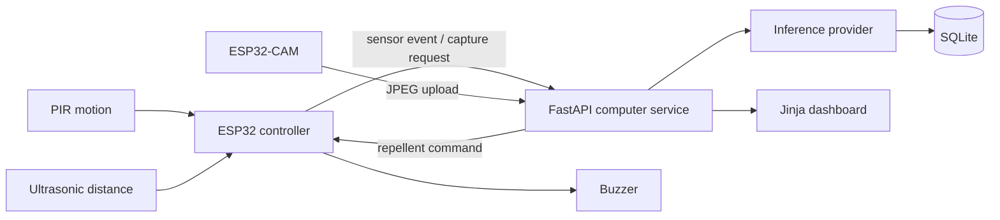

# Smart Pigeon Repellent System

An educational IoT portfolio implementation for detecting likely pigeons near windows, ledges, and industrial structures. A sensor ESP32 confirms motion and distance, an ESP32-CAM supplies an image, and a computer-side FastAPI service performs configurable machine-learning inference before coordinating a bounded, adaptive-frequency buzzer response.

> Hardware and model performance are not validated by this repository. Detection quality depends on the selected model and its training data; changing buzzer frequency does not guarantee that pigeons cannot adapt.

## Architecture



## Workflow

The controller only requests an image after PIR motion and a valid ultrasonic distance below the configured threshold. The server validates the JPEG, runs either the explicitly labelled mock provider or a replaceable detector adapter, records the result, and exposes a repellent command only when confidence is sufficient. Sensor activity is never treated as proof of a pigeon. The firmware reports repellent start, frequency changes, completion, timeout, and communication failure; the database records activation only as commanded until device evidence arrives.

## Repository layout

`app/` contains the API, database, inference and dashboard. `firmware/esp32/` is the sensor/controller MicroPython application; `firmware/esp32_cam/` documents the camera-board adapter boundary. `ml/` contains model guidance. `migrations/` contains Alembic setup. `tests/` contains API and inference tests.

## Setup

```bash
python -m venv .venv
# Windows: .venv\\Scripts\\activate
pip install -r requirements.txt
copy .env.example .env   # Windows; use cp on Linux/macOS
alembic upgrade head
uvicorn app.main:app --reload
```

Open `http://127.0.0.1:8000/` and API documentation at `/docs`. The default `INFERENCE_PROVIDER=mock` is simulated development behavior and never represents real pigeon detection. For real inference, implement/configure a model adapter and set `MODEL_PATH`; do not commit weights. A YOLO-family model must have a compatible pigeon label (pretrained general models are not assumed to recognize pigeons).

### Windows development

In PowerShell from the repository directory:

```powershell
py -3 -m venv .venv
.\.venv\Scripts\Activate.ps1
python -m pip install -r requirements.txt
Copy-Item .env.example .env
alembic upgrade head
uvicorn app.main:app --reload
```

Run the automated tests with `python -m pytest -q`. The server and dashboard use only local SQLite records; no cloud service is required. The server-side protocol is: authenticated sensor event → capture request → authenticated JPEG upload → inference → confirmed detection and queued repellent command → device command polling → device status and frequency reports. Mock inference never queues a repellent command.

## Device integration

Set `DEVICE_TOKEN` and send `X-Device-Token` with device requests. The controller's `config.py` contains wiring placeholders. Copy the `firmware/esp32` modules to the sensor board and provide an HTTP bridge for the camera board. ESP32-CAM MicroPython camera APIs vary by board and firmware build; adapt `camera_adapter.py` to the exact module/API and use a level shifter or divider where required by the ultrasonic echo voltage. Never hard-code Wi-Fi credentials.

## Tests and limitations

Run `pytest`. Tests cover the mock inference contract, health endpoint, authentication, sensor ingestion, and invalid device input; image and repellent endpoint tests can be extended with a temporary database fixture. In this repository, mock inference is the only guaranteed development mode. Physical wiring, camera capture, Wi-Fi behavior, model accuracy, and nuisance-reduction performance require hardware and field validation. SQLite is suitable for local use; production deployments need stronger operational controls.
